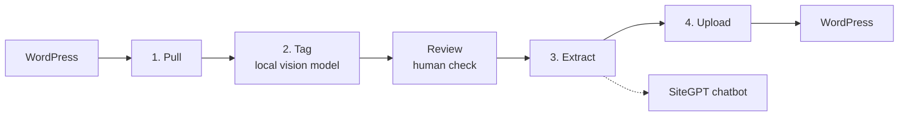

# Heritage Library alt-text pipeline

Generates accessibility alt text and word-for-word transcriptions for a digitised
heritage image collection hosted in WordPress, using open-source vision models that
run locally. The results are published back to the site and used to train a chatbot.

Built as a Kappa Theta Pi (UofSC) project for the
Heritage Library, a nonprofit history and genealogy
library on Hilton Head Island, South Carolina.

## The problem

The library's website held about 1,050 digitised images with no alt text. These
include 1860s Head of Family Land Certificates, obituaries and newspaper clippings,
photographs and maps. Screen-reader users couldn't access them, and the handwritten
documents couldn't be searched, because their text existed only inside the image.

## What it does



| Stage | Script | What it does |
| --- | --- | --- |
| 1. Pull | `pipeline/wp_media_pull.py` | Downloads images that have no alt text, plus an `inventory.csv` manifest, through the WordPress REST API |
| 2. Tag | `pipeline/alt_text_tagger.py` | Captions and transcribes each image with a local Ollama vision model, and embeds the results as IPTC/XMP accessibility metadata using exiftool |
| Review | `review_app.py` | Small Flask viewer for a person to check the output |
| 3. Extract | `pipeline/extract_alt_inventory.py` | Reads the embedded metadata, including any later human edits, into a flat CSV |
| 4. Upload | `pipeline/wp_upload_alt.py` | Writes alt text to each attachment's alt field and the transcription to its description |

Other scripts:
- `pipeline/find_retries.py` selects rows from a tagging report that are worth re-running.
- `sitegpt/` builds knowledge files for a [SiteGPT](https://sitegpt.ai) chatbot from the results.

Each image gets three pieces of text:
- **Alt text:** one sentence describing what the image shows, for screen readers.
- **Extended description:** on documents, every legible word transcribed verbatim, with
  `[illegible]` and `[word?]` markers. On photographs, a detailed visual description.
- **Visible text:** the same text flattened onto one line, for keyword search.

## Results

- 1,040 images published with alt text and transcriptions, with zero upload errors.
- More than 600 land certificates and 195 obituaries and clippings became searchable by name.
- A chatbot trained on the results answers family-history questions and links to the
  original scans. It is currently on the library's staging site.

## Setup

You need Python 3.9 or later, plus two programs that aren't Python packages:
- [exiftool](https://exiftool.org) on your PATH
- [Ollama](https://ollama.com) with a vision model pulled

```bash
python -m venv .venv
.venv\Scripts\activate          # Windows; on Linux or macOS: source .venv/bin/activate
pip install -r requirements.txt
ollama pull qwen2.5vl:7b        # or qwen3-vl:2b on a smaller GPU
cp .env.example .env            # then fill in your site URL and credentials
```

`.env` holds `WP_BASE_URL`, `WP_USER` and `WP_KEY`. `WP_KEY` is a WordPress
**Application Password** (Users → Profile → Application Passwords), not your login
password. Check your credentials with `python misc/wp_access_test.py`.

## Usage

```bash
# 1. Pull (settings are constants at the top of the script)
python pipeline/wp_media_pull.py

# 2. Tag: start small and read the report before a full run
python pipeline/alt_text_tagger.py library_images --out-dir tagged --limit 10 \
    --collection-context "1860s land certificates, obituaries and photographs from Hilton Head Island, SC"

# Review the output in a browser at http://localhost:60606
python review_app.py tagged

# 3. Extract what the files now carry
python pipeline/extract_alt_inventory.py tagged -o alt_inventory.csv \
    --inventory library_images/inventory.csv

# 4. Upload: a dry run unless you pass --apply
python pipeline/wp_upload_alt.py alt_inventory.csv --limit 5
python pipeline/wp_upload_alt.py alt_inventory.csv --apply

# Undo an upload
python pipeline/wp_upload_alt.py --restore upload_log.csv --apply
```

Tagging and pulling are both resumable: re-run the same command and they skip work
that's already done. Expect tagging to take hours for a full collection. It runs at
roughly 20 seconds to several minutes per image, depending on the model and GPU.

## Safety by design

This targets a live website whose existing content may have been written by hand,
and a collection of historical records about real people.

- **Dry run by default.** Nothing is written to the site without `--apply`.
- **Never overwrites human work.** Alt text and descriptions already on the site are
  left alone unless you explicitly ask for them to be replaced. The public caption is
  never touched.
- **Reversible.** Every write logs the previous values, and `--restore` undoes them
  without clobbering edits made since.
- **Private.** Images are processed by local models and are never sent to a commercial
  AI service. Credentials live only in `.env`, which git ignores, and no site address
  appears in the source.
- **Honest about AI.** The prompt forbids inventing dates, places or identities.
  Output carries a confidence rating and is meant to be reviewed by a person.
  Transcriptions are labelled as machine-generated wherever they're published.

## Repository layout

```
pipeline/     the four pipeline stages and find_retries.py
review_app.py human review UI
sitegpt/      chatbot knowledge-file export (only the scripts are tracked)
misc/         diagnostic and scratch scripts
wp_config.py  the single place site settings are read from .env
```

The downloaded images, tagged output, reports and logs are all git-ignored.
